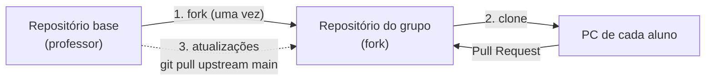

# Comece aqui

Este é o **repositório base** do Projeto Integrador da Sprint 5. Ele traz:

- o **projeto base** (Angular + NestJS + MongoDB) com o módulo de exemplo **Produtos**;
- o **manual do seu tema**, com os campos, regras, rotas e telas de cada módulo (`guia/temas/`);
- as **receitas** para os problemas que aparecem em todos os temas (`guia/RECEITAS.md`);
- o **Manual de Construção**, os **templates** dos documentos e as **responsabilidades** de cada papel (`guia/`).

Durante a sprint, o professor publica aqui **atualizações** (correções, novos testes, novas receitas). O seu grupo trabalha numa **cópia** deste repositório (um *fork*) e puxa essas atualizações quando elas saírem.



---

## Passo 1 — Criar o repositório do grupo (só o papel **Git e Integração**, uma vez)

1. Entre no GitHub com a sua conta e abra o repositório base:
   **https://github.com/EderRosso/projeto-integrador-base**
2. Clique em **Fork** (canto superior direito).
   - **Repository name:** `grupo-N-tema` (ex.: `grupo-3-academia`)
   - Deixe marcado **Copy the main branch only**.
   - Clique em **Create fork**.
3. No fork, vá em **Settings → Collaborators → Add people** e adicione os 5 colegas e o professor.
4. Ainda no fork, abra a aba **Actions** e clique em **I understand my workflows, go ahead and enable them** (liga os testes automáticos de cada Pull Request).
5. Crie a branch de integração `develop`: na página do fork, clique no seletor de branch (`main`), digite `develop` e clique em **Create branch: develop from main**.
6. Em **Settings → General → Default branch**, troque para `develop`.
7. Em **Settings → Branches → Add branch ruleset** (ou *Add rule*), proteja a `main` exigindo Pull Request.

Pronto. Passe o link do fork para o grupo e registre-o no formulário dos grupos.

## Passo 2 — Clonar e preparar (todos os alunos, uma vez)

No terminal do VS Code, dentro da pasta onde você guarda seus projetos:

```bash
# 1) Clone o repositório DO GRUPO (o fork), não o do professor
git clone https://github.com/USUARIO-DO-COLEGA/grupo-N-tema.git
cd grupo-N-tema

# 2) Ligue o seu clone ao repositório base, para receber as atualizações
git remote add upstream https://github.com/EderRosso/projeto-integrador-base.git
git remote -v        # deve mostrar "origin" (grupo) e "upstream" (professor)

# 3) Identifique-se (se ainda não fez neste computador)
git config --global user.name "Seu Nome"
git config --global user.email "seu-email@exemplo.com"
```

Depois, rode o projeto como explica o `README.md` (instalar, copiar o `.env`, `npm run seed`, `npm run start:dev` e `npm start`).

## Passo 3 — Trabalhar no seu módulo (todo dia)

O fluxo completo está em [`CONTRIBUTING.md`](CONTRIBUTING.md) e no passo a passo ilustrado para iniciantes em [**`guia/GIT-E-GITHUB.md`**](guia/GIT-E-GITHUB.md). Resumo:

```bash
git checkout develop
git pull                                   # traz o que os colegas já juntaram
git checkout -b pets/listagem              # <modulo>/<o-que-vai-fazer>
# ... programa, testa ...
git add .
git commit -m "feat(pets): tela de listagem com filtro por espécie"
git push -u origin pets/listagem
# no GitHub: Pull Request de pets/listagem → develop
```

## Passo 4 — Receber as atualizações do professor

Quando o professor avisar no Classroom que saiu uma atualização, **o papel Git e Integração** faz:

```bash
git checkout develop
git pull                          # deixa a develop do grupo em dia
git fetch upstream                # baixa as novidades do professor
git merge upstream/main -m "chore: atualização do repositório base"
git push                          # envia para o repositório do grupo
```

Depois, **cada aluno** traz a atualização para a branch em que está trabalhando:

```bash
git checkout develop
git pull
git checkout minha-branch
git merge develop
```

O que mudou em cada atualização (e se o grupo precisa fazer alguma coisa) fica em [`ATUALIZACOES.md`](ATUALIZACOES.md).

### Quem mexe em quê

As atualizações do professor só mexem nos arquivos da coluna da esquerda. Por isso, **não altere esses arquivos**: assim as atualizações entram sem conflito.

| Arquivos do professor (não altere) | Arquivos do grupo (são de vocês) |
| --- | --- |
| `COMECE-AQUI.md`, `ATUALIZACOES.md`, `CONTRIBUTING.md` | `README.md` (vira o README do projeto) |
| `guia/` (manuais, receitas, templates) | `docs/` (documentos do grupo) |
| `.github/` (testes automáticos e modelos) | `backend/src/<seus-módulos>/` |
| `backend/src/common/`, `backend/src/main.ts` | `backend/src/app.module.ts`, `backend/src/seed/seed.ts` |
| `backend/src/produtos/` (exemplo) | `frontend/src/app/features/<seus-módulos>/` |
| `backend/testes-obrigatorios/` | `frontend/src/app/app.config.ts`, `app.routes.ts` |
| `frontend/src/app/core/` | `frontend/src/app/layout/`, `frontend/src/app/pages/` |
| `frontend/src/app/features/produtos/` (exemplo) | `frontend/src/environments/` |
| `frontend/src/styles.css` | `frontend/src/estilos-do-grupo.css` (estilos do grupo) |

> Quer mudar uma cor ou um botão? Faça em `estilos-do-grupo.css`: ele é carregado depois do `styles.css` e vence.

### Deu conflito no merge?

O Git avisa `CONFLICT` e lista os arquivos.

- **Arquivo do professor** (coluna da esquerda): fique com a versão do professor.
  ```bash
  git checkout --theirs caminho/do/arquivo
  git add caminho/do/arquivo
  ```
- **Arquivo do grupo:** abra no VS Code, escolha **Accept Both Changes** ou ajuste à mão, salve e `git add`.
- Depois de resolver todos: `git commit` e `git push`.

Se travar, **não apague a pasta nem force nada**: chame o professor.

---

## Onde está cada coisa

| Preciso de... | Onde |
| --- | --- |
| Saber o que o meu módulo tem (campos, regras, rotas, telas) | `guia/temas/<seu-tema>.md` |
| Saber **como** fazer cada etapa, aula a aula | `guia/Manual de Construção - Projeto Integrador.docx` |
| Entender o fluxo de Git/GitHub passo a passo (para iniciantes) | [`guia/GIT-E-GITHUB.md`](guia/GIT-E-GITHUB.md) |
| Resolver referência entre módulos, busca, datas, status | `guia/RECEITAS.md` |
| Saber o que o meu papel transversal entrega | `guia/Responsabilidades dos Integrantes - Projeto Integrador.docx` |
| Preencher os documentos do grupo | `guia/templates/` → salve a versão preenchida em `docs/` |
| Ver um exemplo de cada documento já preenchido | [`guia/exemplos/`](guia/exemplos/) |
| Ver o que mudou na base | `ATUALIZACOES.md` |

| Tema | Manual |
| --- | --- |
| Pet shop | [guia/temas/pet-shop.md](guia/temas/pet-shop.md) |
| Biblioteca | [guia/temas/biblioteca.md](guia/temas/biblioteca.md) |
| Academia | [guia/temas/academia.md](guia/temas/academia.md) |
| Oficina mecânica | [guia/temas/oficina-mecanica.md](guia/temas/oficina-mecanica.md) |
| Clínica | [guia/temas/clinica.md](guia/temas/clinica.md) |

## Problemas comuns

| Mensagem | O que fazer |
| --- | --- |
| `fatal: not a git repository` | Você não está na pasta do projeto: `cd grupo-N-tema` |
| `error: remote upstream already exists` | O upstream já foi configurado. Confira com `git remote -v` |
| `refusing to merge unrelated histories` | O repositório do grupo não foi criado por **Fork**. Chame o professor |
| `Your local changes would be overwritten` | Faça `git add .` e `git commit` antes de trocar de branch ou fazer merge |
| `Cannot read properties of null (reading 'edgesOut')` no `npm install` | Rode `npx npm@11 install` |
| `ECONNREFUSED 127.0.0.1:27017` | O MongoDB não está rodando. Inicie o serviço do MongoDB |
| Teste automático (✗ vermelho) no Pull Request | Clique em **Details**, veja qual passo falhou e rode o mesmo comando no seu PC |
