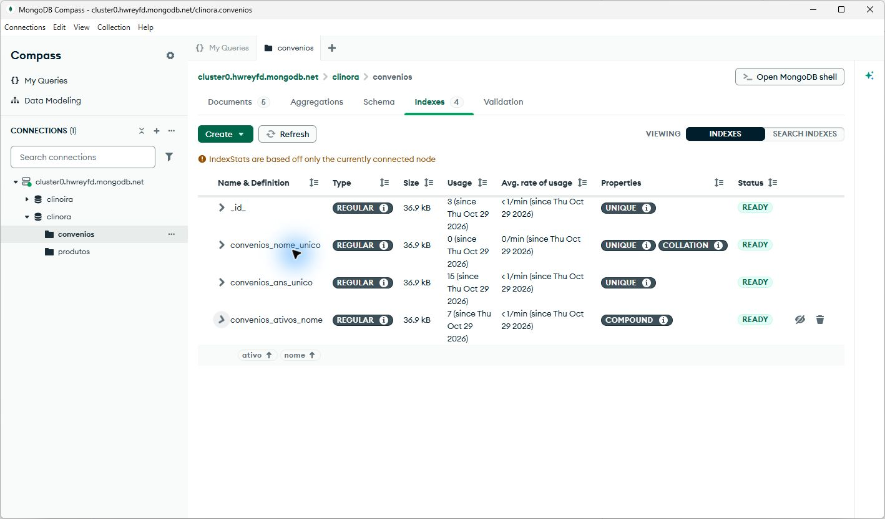

# Banco de dados de Convênios com Mongoose

Registro da atividade de 29 de outubro de 2026

Grupo 5 Clinora • Módulo E Convênios • Aula 7 conforme a identificação da atividade pelo grupo

Foi criado o módulo de Convênios no backend NestJS, com schema Mongoose, validações, enum, valores padrão, índices e timestamps. O seed foi executado no MongoDB Atlas e inseriu cinco convênios fictícios. A segunda execução reconheceu os mesmos registros, sem duplicá-los nem alterar seus IDs, campos ou datas.

Este registro apoia a documentação e a apresentação do grupo. A entrega está na branch convenios/schema-seed do fork de ValentinadelosAngeles, no PR https://github.com/bryanantonii/Grupo-5-Clinica/pull/5, com destino à develop do grupo.

## Resultado da entrega

| Item | Resultado observado |
| --- | --- |
| Banco e coleção | clinora.convenios no Cluster0 do Atlas informado |
| Módulo NestJS | Gerado pelo CLI e importado no AppModule |
| Model Mongoose | Registrado por forFeature e recuperado pelo token do Nest |
| Cinco exemplos | 5 registros no banco sendo 4 ativos e 1 inativo |
| Validações e enum | 17 testes do schema aprovados |
| Testes do backend | 25 testes locais e execução padrão aprovada na CI |
| Lint e builds | Lint do backend e builds do backend e frontend aprovados |
| Conferência visual | Atlas e Compass com 5 documentos e 4 índices prontos |
| Compass | Filtros de ativos, inativo e ANS com zero inicial conferidos |
| Integração Git | PR aberto para revisão de outro integrante |

O banco clinora já existia antes desta atividade. A coleção convenios foi criada a partir do model e do seed. A coleção didática produtos foi mantida; o comando também inseriu seus cinco exemplos, usando o mesmo comportamento de preservar registros existentes.

## O que continua para as próximas etapas

Esta entrega prepara a persistência do módulo E. Não acrescenta controller HTTP, autenticação, autorização ou integração do Angular com a API. O frontend do C1 continua na branch clinica/c1-frontend; esta branch de banco parte da develop e não incorpora o PR anterior do frontend.

<!-- pagebreak -->

## Parte 1 Schema e model

O schema define os campos, tipos e regras de um documento. O model é a ferramenta criada a partir desse schema para consultar e gravar documentos na coleção. Uma interface TypeScript ajuda na compilação; as validações do Mongoose são executadas durante as operações do model.

O arquivo backend/src/convenios/schemas/convenio.schema.ts define a coleção convenios. A opção timestamps cria createdAt e updatedAt nas operações normais do Mongoose. O MongoDB gera um ObjectId para _id quando o registro é criado.

| Campo | Tipo | Regra ou padrão |
| --- | --- | --- |
| nome | Texto | Obrigatório com 3 a 60 caracteres e índice único |
| codigoAns | Texto | Obrigatório com exatamente 6 dígitos e índice único |
| percentualCobertura | Número | Obrigatório e inteiro entre 0 e 100 |
| telefone | Texto opcional | Formato com DDD e 8 ou 9 dígitos locais |
| modalidade | Texto com enum | individual ou coletivo com padrão individual |
| ativo | Booleano | Padrão true |
| createdAt e updatedAt | Datas | Gerenciadas por timestamps |

O código ANS fica como texto para preservar zeros à esquerda, como no exemplo 045678. Os campos de texto recebem trim para remover espaços das extremidades. A validação Number.isInteger impede coberturas como 80,5, mesmo dentro do intervalo numérico.

O campo modalidade é uma extensão confirmada durante a atividade para exercitar o enum. Ele não constava no guia original de Convênios. O formulário e o contrato HTTP precisam considerar essa extensão quando forem integrados; a revisão do PO e do grupo permanece pendente. A criação pode omitir o campo e receber o valor padrão individual.

## Registro no NestJS

O módulo foi gerado com o comando abaixo e recebeu o registro do model:

```text
npx --no-install nest generate module convenios --no-spec
MongooseModule.forFeature([
  { name: Convenio.name, schema: ConvenioSchema }
])
```

ConveniosModule foi importado em AppModule. O verificador utiliza getModelToken(Convenio.name) para obter o model pelo container do Nest. Isso confirmou que o registro funciona com a conexão real, além da compilação.

<!-- pagebreak -->

## Parte 2 Índices e seed

Há quatro índices no Atlas: _id_, criado pelo MongoDB; convenios_nome_unico; convenios_ans_unico; e convenios_ativos_nome. O índice do nome usa collation em português com strength 1, que considera equivalentes diferenças de maiúsculas e acentos. O índice composto por ativo e nome pode apoiar filtros e ordenação compatíveis; ele não garante eficiência para qualquer busca por trecho com regex.

A opção unique cria um índice no banco; ela não substitui um validador do Mongoose. O seed aguarda model.init() para garantir que os índices estejam disponíveis. A conferência tentou inserir novamente um exemplo existente e recebeu E11000, sem criar um sexto registro.

## Cinco registros fictícios

| Nome | ANS | Cobertura | Modalidade e situação |
| --- | --- | --- | --- |
| Saúde Mais | 123456 | 80% | individual ativo |
| Vida Plena | 234567 | 70% | coletivo ativo |
| Bem Cuidar | 345678 | 100% | individual ativo |
| Proteção Familiar | 045678 | 50% | coletivo ativo |
| Horizonte Saúde | 567890 | 0% | individual inativo |

Os exemplos exercitam zero à esquerda, cobertura nos limites, telefone opcional, modalidade coletiva e registro inativo. Não representam convênios reais nem dados de pacientes.

O helper inserirExemplos valida cada documento e utiliza upsert com $setOnInsert. Apenas os exemplos ausentes são inseridos. Dados existentes não são apagados nem sobrescritos. Para preservar suas datas na repetição, o seed informa as datas de criação no $setOnInsert e desativa a atualização automática de timestamps apenas nessa operação de seed.

## Como repetir

Na pasta backend, com MONGODB_URI configurada no .env local:

```text
npm run seed
npm run verificar:convenios
```

A primeira execução inseriu 5 convênios e 5 produtos. A segunda informou 0 inseridos e 5 existentes em cada módulo. A comparação dos registros antes e depois confirmou os mesmos IDs, campos, createdAt e updatedAt. Os detalhes estão em evidencias/verificacao-banco.json.

<!-- pagebreak -->

## Parte 3 Evidências no Atlas e Compass

O Data Explorer do projeto clinora mostrou a coleção convenios com 5 documentos e 4 índices. Os identificadores dos exemplos na interface coincidem com os obtidos pelo verificador conectado pelo NestJS. Os quatro índices foram conferidos com status Ready.

O Compass 1.53.2 aberto neste PC também conectou ao Atlas e mostrou os mesmos cinco registros. O filtro de ativos retornou quatro documentos; o de inativos retornou Horizonte Saúde. A busca pelo ANS 045678 retornou Proteção Familiar, preservando o zero inicial como texto. As datas aparecem como ISODate.



Os quatro índices apareceram como READY. Os índices de nome e ANS estão marcados como UNIQUE; o índice convenios_ativos_nome contém ativo e nome em ordem crescente. As capturas dos documentos, filtros e índices estão em evidencias. O arquivo compass-verificacao.json registra os resultados da conferência visual, complementando verificacao-banco.json.

<!-- pagebreak -->

## Parte 4 Testes segurança e erros comuns

Os 17 testes do schema cobrem os cinco exemplos, padrões, enum inválido, nome curto ou longo, ANS inválido, cobertura negativa, maior que 100 e fracionária, telefone inválido, campos obrigatórios, trim e rejeição de campos desconhecidos. Somados aos 8 testes do módulo didático Produtos, foram aprovados 25 testes Jest.

O comando npm test encontrou uma limitação deste Windows: o Controle de Aplicativo bloqueou a extensão nativa do resolvedor do Jest. Os mesmos testes passaram com um resolvedor JavaScript local, sem mudar a configuração do repositório nem desativar a proteção. A execução padrão do backend também passou na CI do PR, assim como o build do frontend. O resultado local está resumido em evidencias/testes.json.

O lint e o build do backend passaram. O build do frontend da develop também passou. O verificador real confirmou o registro do model no Nest, os cinco exemplos, os timestamps e o bloqueio de duplicidade pelo índice do MongoDB.

## Cuidados na modelagem

- A conexão é lida do .env local. A URI, a senha do banco e tokens não fazem parte dos commits, das capturas ou desta documentação.
- strict e strictQuery com valor throw rejeitam campos desconhecidos no documento e no filtro. Campos de senha ou permissão não pertencem ao schema de Convênios.
- O schema Mongoose valida operações feitas pelo model. Ele não cria automaticamente um validator JSON Schema na coleção do Atlas; escrita direta por outro cliente pode contornar essas regras.
- Validar formato não substitui regras de negócio nem autorização. As futuras rotas HTTP precisarão de DTOs, filtros permitidos e validação de sessão e perfil no servidor.
- Na edição com update, manter runValidators: true. Não tratar unique como validação em memória: a duplicidade é bloqueada pelo índice e precisa ser traduzida pelo futuro service.

## Conferência no Compass

A conferência foi concluída em 29 de outubro no Compass 1.53.2 aberto neste PC. Foram feitas apenas consultas, sem editar ou excluir documentos. A conexão não foi salva no aplicativo. O guia-compass.md reúne os resultados, as capturas e os passos para repetir a demonstração.

<!-- pagebreak -->

## Parte 5 Roteiro de apresentação

### Explicação inicial

Nesta atividade criamos a persistência do módulo E, Convênios. Definimos um schema Mongoose com os campos e as regras, registramos o model no Nest e executamos um seed com cinco exemplos no Atlas. Antes o frontend demonstrava o funcionamento com mocks; agora temos a base do backend preparada para a próxima integração.

### Demonstração

1. Abra convenio.schema.ts e mostre os campos obrigatórios, o ANS como texto e o validador de número inteiro para cobertura.
2. Mostre modalidade como enum e os padrões individual e ativo true. Explique que modalidade é o campo acrescentado para esta atividade e documentado para revisão.
3. Abra convenios.module.ts e aponte o forFeature. Mostre ConveniosModule no AppModule.
4. Execute npm run seed. Na repetição, mostre 0 inseridos e 5 existentes. Explique que o comando preserva os dados e as datas.
5. Execute npm run verificar:convenios e abra clinora.convenios no Compass. Mostre os cinco registros, os filtros de ativo e ANS 045678, as datas e a aba Indexes com os quatro índices READY.
6. Abra o PR para mostrar o diff, a documentação e os checks. A integração na develop depende da revisão de outro integrante.

### Respostas para perguntas

Schema e model são iguais? O schema define a estrutura e as regras. O model utiliza essa estrutura para ler e gravar documentos no banco.

O enum faz o quê? Limita modalidade aos valores individual e coletivo. Um valor diferente é rejeitado durante a validação.

Por que usar índice único? Para o MongoDB bloquear duplicidades mesmo com operações concorrentes. A tentativa duplicada na conferência retornou E11000.

O seed apaga o banco? Este seed insere apenas exemplos ausentes. Ele não apaga nem atualiza os documentos existentes.

As telas já usam esse banco? Ainda não. Esta entrega prepara schema, model e seed; a integração HTTP e a autenticação pertencem às próximas etapas.

## Referências

Enunciado da atividade e guia/temas/clinica.md do projeto. O material base associa schema e seed à aula 08; o grupo identificou esta atividade como aula 7. Os slides 9 a 15 não foram anexados a esta execução, portanto o registro se baseia nos tópicos fornecidos e no guia disponível.

Documentação oficial: https://docs.nestjs.com/techniques/mongodb, https://mongoosejs.com/docs/validation.html e https://mongoosejs.com/docs/timestamps.html.
