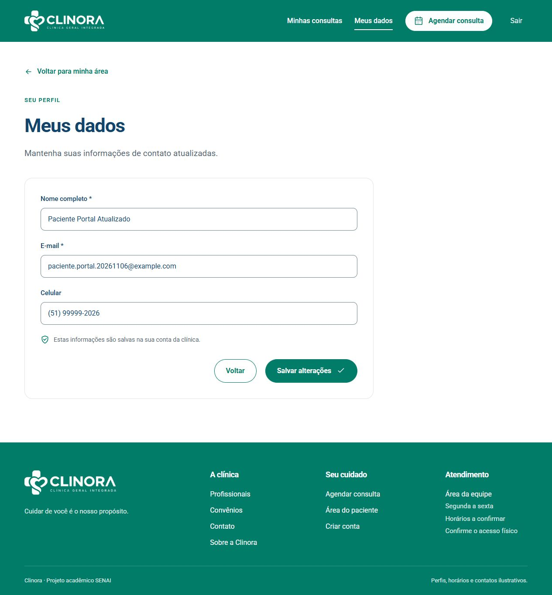

# Cadastro e login públicos do paciente

Correção de 6 de novembro de 2026. O cadastro público anterior era uma demonstração: criava um perfil no navegador, sem inserir uma conta no MongoDB. O cadastro, o login e Meus dados agora usam a API e a coleção `clinora.usuarios`.

## Comportamento atual

- `/criar-conta` envia nome, e-mail e senha para POST `/api/v1/auth/cadastro-paciente`. A API grava o usuário com perfil fixo `paciente`, senha bcrypt e timestamps. A confirmação aparece somente após o sucesso da API.
- `/entrar` usa POST `/api/v1/auth/login-paciente`. Senha incorreta, usuário ausente ou inativo recebem 401. Uma conta da equipe deve usar `/login`.
- `/meus-dados` usa GET e PATCH `/api/v1/conta`. O titular é determinado pelo ID do token. Nome, e-mail e telefone são salvos no MongoDB.
- E-mail repetido retorna 409; dados inválidos ou campos extras retornam 400. O visitante não escolhe perfil, status, ID ou referência clínica.
- O JWT do paciente vai somente para a API da própria conta. Sua sessão fica separada da equipe e não guarda senha nem hash. O antigo perfil de demonstração no cache não libera a área.
- O backend bloqueia pacientes nas rotas da gestão, inclusive nas rotas privadas que não têm um perfil explicitamente anotado.

## Como conferir no Compass

1. Crie uma conta de teste pela tela pública.
2. Abra `clinora` → `usuarios` e filtre pelo e-mail informado.
3. Confira `perfil: "paciente"`, `ativo: true`, nome e timestamps. Não apresente o hash ou os dados de acesso.
4. Edite nome ou telefone em Meus dados. Salve e atualize a consulta no Compass.
5. Saia e entre novamente. A API deve devolver os dados atualizados. Teste também uma senha incorreta e o cadastro repetido.

A conta usada na conferência foi `paciente.portal.20261106@example.com`. O nome passou para **Paciente Portal Atualizado**, e o telefone foi alterado para `(51) 99999-2026`. O cadastro veio do formulário público e a leitura direta do MongoDB confirmou a persistência. A senha de teste não foi incluída na documentação.

## Verificação realizada

Passaram 143 testes do backend em 17 suítes e 90 testes de frontend, incluindo 32 de rotas. As 31 verificações de autenticação da equipe e as 81 de integração dos módulos também passaram após esta correção. O novo comando `npm run verificar:conta -- --registrar`, dentro de backend, confere 56 casos HTTP/MongoDB em banco temporário separado e remove somente esse banco próprio.

As [56 verificações da API](evidencias/conta-paciente.json) e as [9 conferências do fluxo e da persistência](evidencias/conta-navegador.json) registram os resultados. Os arquivos obrigatórios do professor foram preservados byte a byte. Os testes locais de backend usam `npm run test:compat` devido ao bloqueio nativo do laboratório; o CI mantém `npm test`.

## Limites deste ajuste

A conta de acesso em `usuarios` é diferente da ficha clínica em `pacientes`. O cadastro público não cria automaticamente uma ficha nem vincula prontuários antigos apenas pelo e-mail. Essa associação exige uma verificação de identidade que ainda não existe nesta versão.

Os agendamentos do portal permanecem demonstrativos. Não há confirmação de e-mail nem recuperação automática de senha; a interface não apresenta uma redefinição simulada como se tivesse alterado uma senha real.

Durante a conferência, a API local ainda estava em uma instância antiga porque o reinício automático do Nest falhou no Windows. Reiniciei somente a API identificada do projeto e confirmei as novas rotas no Swagger antes de repetir o teste pela tela.
