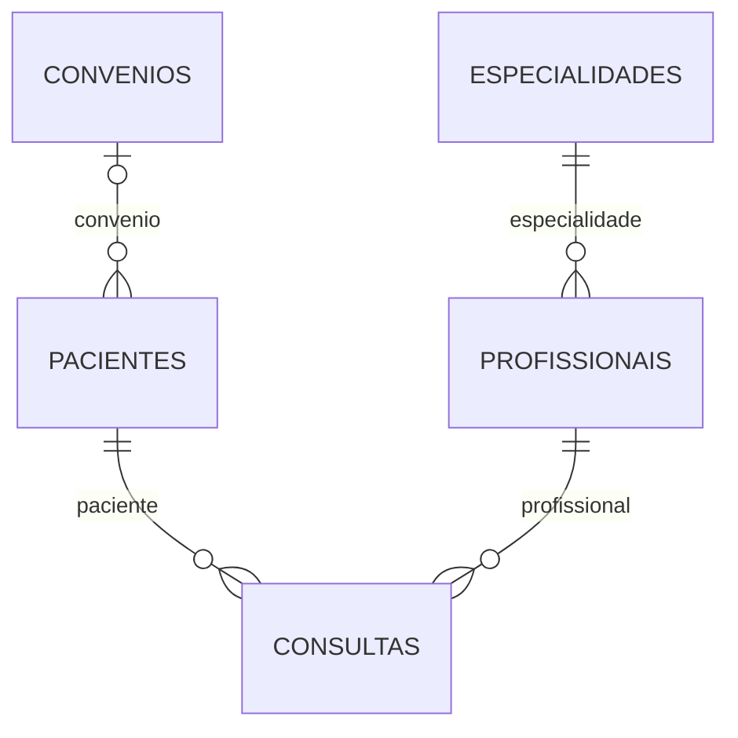

# Banco de dados da Clinora — 5 de novembro de 2026

## O que a clínica oferece

Analisei as telas públicas, a gestão C1, o agendamento, os relatórios, os seeds e
os modelos existentes. O site apresenta atendimento de clínica geral,
cardiologia e dermatologia, profissionais, pacientes, agendamentos, atendimento
particular e convênios. Não há catálogo de mercadorias nem venda de planos
próprios da clínica.

A coleção `produtos` veio do exemplo do professor: o seed cadastrava arroz,
feijão, sabonete, detergente e pilhas. Trocar somente o nome da coleção para
`planos` manteria campos de estoque, categoria e preço de mercadorias, que não
representam o atendimento mostrado no site.

## Coleções que representam o sistema

| Coleção | Dados principais | Onde aparece no site |
| --- | --- | --- |
| `pacientes` | Nome, e-mail, telefone, nascimento, convênio opcional e ativo. | Cadastro de pacientes e identificação da pessoa atendida. |
| `profissionais` | Nome, registro profissional, especialidade, e-mail, telefone e ativo. | Equipe, perfil público, gestão e escolha no agendamento. |
| `especialidades` | Nome, descrição, duração da consulta, valor particular e ativo. | Catálogo de atendimento, escolha da especialidade e referência do profissional. |
| `consultas` | Referências ao paciente e ao profissional, data/hora, motivo e status. | Agenda, agendamento, histórico, cancelamento e gestão de consultas. |
| `convenios` | Nome, código ANS, percentual de cobertura, telefone, modalidade e ativo. | Convênios aceitos e vínculo opcional do paciente. |

`_id` identifica cada documento. Os schemas devem usar timestamps para
`createdAt` e `updatedAt`. As ligações no MongoDB usam ObjectId; os IDs textuais
dos mocks, como `mariana-costa`, não devem ser gravados como referências reais.

Os relatórios devem ser calculados a partir desses cadastros e das consultas.
Não é necessário criar outra coleção com cópias das contagens nesta etapa.

## Convênios ou planos?

Na tela pública de Convênios, o campo “plano” pede o nome do convênio do paciente
e encaminha uma solicitação de confirmação para Contato. Isso não representa
assinatura, compra de pacote ou plano vendido pela Clinora.

Por isso, a estrutura atual deve continuar com `convenios`. Se o grupo decidir
controlar vários planos de um convênio, poderá criar `planos` com referência ao
convênio, nome do plano, cobertura e situação, após definir os requisitos. Se a
clínica passar a vender pacotes próprios, será outra funcionalidade, com regras
de contratação e pagamento. Nenhuma dessas funcionalidades foi inventada nesta
correção.

## O que encontrei no MongoDB

Conferência do banco `clinora` em 5 de novembro de 2026, antes de qualquer limpeza:

| Coleção | Registros | Situação |
| --- | ---: | --- |
| `profissionais` | 3 | Schema, API CRUD e integração HTTP com o Angular disponíveis. |
| `especialidades` | 3 | Registros básicos usados como referência pela API de Profissionais. |
| `convenios` | 5 | Schema, índices, seed e service disponíveis; a tela de gestão ainda usa mock. |
| `produtos` | 5 | Exemplos didáticos sem relação com a clínica. Backup local preparado. |
| `pacientes` | — | Coleção ainda não existente; a tela usa dados demonstrativos. |
| `consultas` | — | Coleção ainda não existente; os fluxos públicos e da gestão usam dados demonstrativos. |

As Especialidades existentes têm nome, descrição e ativo. O schema completo do
módulo D e os campos de duração e valor particular ainda precisam ser entregues;
os valores vistos na gestão estão no mock. O seed não substitui esse módulo.

O acesso também é demonstrativo. Esta alteração não cria usuários, senhas,
prontuários, pagamentos, estoque ou vendas. Dados de contato e consultas usados
para testes devem continuar fictícios.

## Correção realizada no projeto

- Retirei o registro de `ProdutosModule` do backend, para que o exemplo não
  exponha rotas nem recrie a coleção na inicialização da Clinora.
- Retirei a rota `/produtos` e os providers de Produtos do Angular. O endereço
  passa a ser tratado pela página não encontrada já existente.
- Mantive os arquivos didáticos de Produtos para consulta pelo grupo. Após a
  revisão das rotas, eles foram movidos para `referencias/produtos/`, fora dos
  aplicativos.
- O comando `npm run seed` agora insere somente os exemplos dos módulos
  disponíveis: cinco Convênios, três Especialidades básicas e três Profissionais.
- Unifiquei o seed em uma conexão e preservei `npm run seed:profissionais`.
- Corrigi a repetição do seed de Profissionais para preservar também os
  timestamps de registros existentes.
- O seed exige `MONGODB_URI` configurada, em vez de escolher outro banco
  silenciosamente quando faltar a configuração.

Nenhum documento de Produtos foi transformado em plano ou cadastro clínico.
A correção do código não apaga automaticamente a coleção já existente.

## Limpeza autorizada no MongoDB

Após a confirmação do responsável pelo projeto, removi somente a coleção
`clinora.produtos`, com os cinco exemplos didáticos. Antes da exclusão, conferi
que todos os documentos continuavam iguais ao backup completo, que inclui os
registros e os índices.

Comparei também o conteúdo integral das outras coleções antes e depois da
limpeza. Os documentos foram preservados: cinco Convênios, três Especialidades
e três Profissionais. A coleção Produtos não existe mais nesse banco.

O backup permanece salvo localmente como
`backup-produtos-2026-11-05T21-44-40-981Z.json`. A evidência da limpeza está em
[limpeza-produtos-2026-11-05.json](evidencias/limpeza-produtos-2026-11-05.json).

## Conferência inicial da correção do seed

- 86 testes unitários do backend aprovados.
- 30 testes do frontend aprovados.
- ESLint, TypeScript e builds dos dois projetos aprovados.
- `npm run verificar:seed:clinica` aprovado contra um banco temporário separado.
  A conferência executa o seed duas vezes, verifica as três coleções esperadas,
  as referências dos Profissionais e a preservação de IDs, datas, edições e
  registros inativos. O banco temporário é removido ao finalizar.

## Organização das rotas no projeto

Na revisão seguinte, retirei também os arquivos de rotas e controllers de
Produtos das pastas de desenvolvimento. Os 18 arquivos do exemplo estão em
`referencias/produtos/`, com o conteúdo preservado. O link “Área da equipe” foi
atualizado para `/gestao` e a configuração antiga `usarMock` foi retirada.

Os testes atuais da clínica são 78 no backend e 53 no frontend, incluindo 23
testes de navegação real com o Router do Angular. Os oito testes didáticos de
Produtos acompanham o exemplo arquivado e não entram mais nessa contagem.
ESLint, TypeScript e os builds dos dois aplicativos passaram novamente após a
organização.

Os caminhos dos arquivos, as URLs e o que já existe na API estão em
[Rotas da Clinora](rotas-clinora.md).

## Próximas entregas para o grupo

1. Módulo D: completar schema, seed e API de Especialidades, preservando os IDs
   que já são usados por Profissionais.
2. Módulo A: implementar schema, API e seed de Pacientes, com e-mail único,
   nascimento válido e referência opcional a Convênio.
3. Módulo C: implementar schema, API e seed de Consultas, com referências reais,
   validação de horário e fluxo de status. A integração deve unificar o
   agendamento público e a gestão.
4. Módulo E: concluir controller/DTOs e conectar o frontend de Convênios ao
   service existente.
5. Módulo F: consultar os dados persistidos para calcular os relatórios.

Não foi criado um CRUD adicional de Planos nem foram antecipados os módulos dos
colegas nesta correção.

## Texto para apresentar

“Os produtos do banco eram exemplos da base do professor, sem relação com a
Clinora. Analisei as telas e identifiquei cinco cadastros do domínio: Pacientes,
Profissionais, Especialidades, Consultas e Convênios. Desativei o exemplo de
Produtos na aplicação e corrigi o seed para ele não cadastrar mercadorias.
Mantive os convênios como estão, porque o site fala do plano de saúde do paciente,
e não da venda de um plano próprio. Também documentei quais módulos já usam o
MongoDB e quais ainda precisam sair dos mocks.”

Fontes do projeto: `guia/temas/clinica.md`, `backend/src/seed`,
`backend/src/profissionais`, `backend/src/convenios`,
`frontend/src/app/features/gestao`, `frontend/src/app/features/clinora` e
`frontend/src/app/features/relatorios`.
