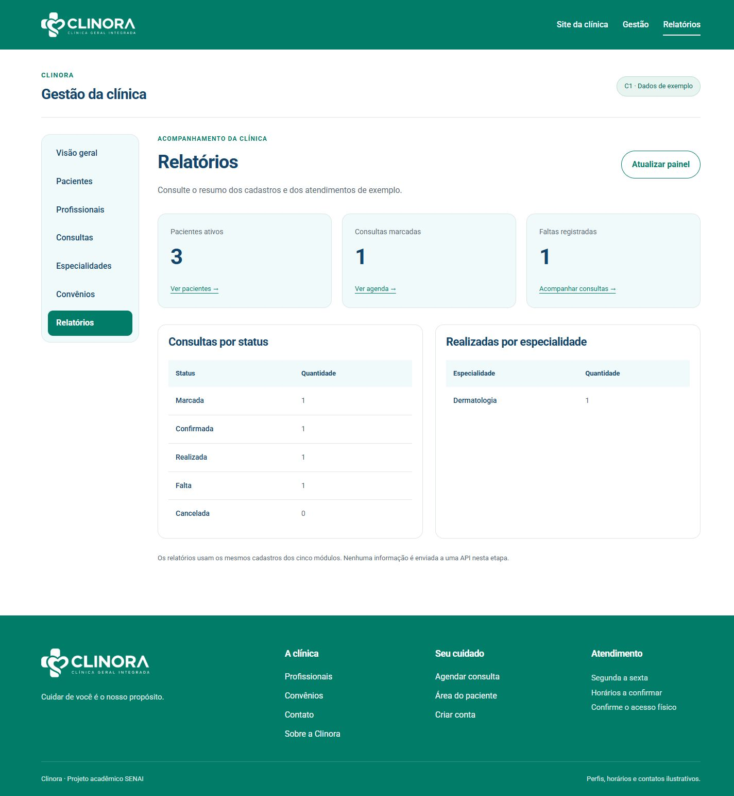

# Checkpoint C1 da Clinora

Registro da atividade de 27 de outubro de 2026

Responsável pelo frontend: henriquerosaaa

O frontend agora tem uma área de Gestão com CRUD navegável de Pacientes, Profissionais, Consultas, Especialidades e Convênios, além do painel inicial de Relatórios. A interface pública que já existia foi preservada. Este registro serve de base para a documentação do grupo e para a apresentação de 28 de outubro.

As telas trabalham com dados fictícios e serviços mock. A conexão com a API e a autenticação real ficam para as próximas etapas. A branch foi enviada pelo usuário henriquerosaaa e o PR 3 está aberto para a develop do grupo. O merge depende da revisão de outro integrante.

## Entrega implementada

| Critério | Situação | Onde conferir |
| --- | --- | --- |
| Cinco módulos com lista cadastro e edição | Implementado e testado | Menu Gestão |
| Formulários com validação | Implementado e testado | Formulários dos cinco módulos |
| Serviços mock registrados | Implementado | app.config.ts |
| Estados de carregando erro e vazio | Implementado e testado | Listas e Relatórios |
| Exclusão com confirmação | Implementado e testado | Ações das listas |
| Tela inicial de Relatórios | Implementado e testado | Gestão e Relatórios |
| Merge na develop | PR 3 aberto para revisão | Repositório do grupo |
| Tag v0.1-c1 | Entrega identificada no fork | Conferir entrega-git.md |

## Como abrir a entrega

```powershell
cd C:\Users\Aluno\Documents\Grupo-5-Clinica\frontend
npm start
```

Abra http://localhost:4200/gestao. O site público continua em http://localhost:4200. Para repetir as verificações, execute npm run test:c1 e npm run build na pasta frontend.

<!-- pagebreak -->

## Parte 1 Rotas e organização

A aplicação continua sendo uma SPA. O navegador carrega a aplicação Angular e o Router troca a tela dentro de router-outlet. O cabeçalho, o rodapé e o menu permanecem no layout durante a navegação.

O app.routes.ts registra /gestao usando loadChildren. O arquivo gestao.routes.ts reúne os módulos e o layout interno. Cada módulo tem seu próprio arquivo de rotas com listagem, cadastro e edição. Isso separa os assuntos e permite carregar as telas conforme a navegação.

| Módulo | Lista | Cadastro | Edição |
| --- | --- | --- | --- |
| Pacientes | /gestao/pacientes | /gestao/pacientes/cadastrar | /gestao/pacientes/editar/:id |
| Profissionais | /gestao/profissionais | /gestao/profissionais/cadastrar | /gestao/profissionais/editar/:id |
| Consultas | /gestao/consultas | /gestao/consultas/cadastrar | /gestao/consultas/editar/:id |
| Especialidades | /gestao/especialidades | /gestao/especialidades/cadastrar | /gestao/especialidades/editar/:id |
| Convênios | /gestao/convenios | /gestao/convenios/cadastrar | /gestao/convenios/editar/:id |

O trecho :id representa o identificador do cadastro selecionado. O formulário lê esse parâmetro com ActivatedRoute, busca o registro e preenche os campos. Depois que o serviço confirma o salvamento, Router.navigate retorna à lista e apresenta a mensagem de sucesso. Um endereço de edição inexistente mostra erro e não vira um cadastro novo por engano.

Os links dos menus usam routerLink e o item atual recebe routerLinkActive e aria-current. A rota coringa ** permanece por último e mostra a página não encontrada. Um guard CanDeactivate avisa quando há alterações não salvas. O guard de sessão já existente continua sendo apenas demonstrativo; o C1 não acrescenta autenticação real à Gestão.

## Arquivos principais

- app.routes.ts e features/gestao/gestao.routes.ts: entrada da área de Gestão e agrupamento das rotas.
- features/<modulo>/<modulo>.routes.ts: rotas de cada módulo.
- features/<modulo>/<modulo>.config.ts: campos, colunas e regras dos formulários.
- features/gestao/shared/: componentes reutilizados de listagem e formulário.
- features/gestao/gestao.models.ts: tipos dos cadastros, filtros e status.

<!-- pagebreak -->

## Parte 2 Formulários e regras

Os formulários são reativos: cada campo pertence a um FormGroup e recebe validadores. As mensagens aparecem junto ao campo após a interação ou após a tentativa de salvar. Um resumo do erro orienta o usuário, e o foco vai para o primeiro campo inválido. Durante o salvamento, os controles ficam desabilitados para evitar cliques repetidos.

### Pacientes

Nome de 3 a 80 caracteres, e-mail válido e único, telefone com DDD e data de nascimento válida, sem data futura. O convênio é opcional e vem dos cadastros ativos. A ausência de convênio aparece como atendimento particular.

### Profissionais

Nome de 3 a 80 caracteres, registro profissional de 4 a 20 caracteres, especialidade existente, e-mail válido e telefone com DDD. O registro é convertido para maiúsculas e não pode ser duplicado. O e-mail também é único. Os cadastros ativos alimentam a listagem pública de profissionais.

### Especialidades

Nome de 3 a 50 caracteres e único. A descrição aceita até 300 caracteres. A duração deve ser um número inteiro entre 15 e 120 minutos, e o valor particular não pode ser negativo.

### Convênios

Nome de 3 a 60 caracteres e único. O código ANS deve ter exatamente seis dígitos e ser único. Ele é tratado como texto para preservar zeros à esquerda. A cobertura é um inteiro de 0 a 100. O telefone é opcional, mas precisa ter formato válido quando preenchido.

### Consultas

Paciente e profissional são selecionados a partir dos cadastros. A data e a hora precisam estar no futuro, em dia útil, a partir das 8h e antes das 18h. O motivo aceita até 300 caracteres. O mock rejeita duas consultas do mesmo profissional no mesmo horário, exceto quando a anterior foi cancelada.

As consultas começam como marcadas. As transições permitidas são marcada para confirmada ou cancelada; confirmada para realizada, falta ou cancelada. Consultas encerradas não oferecem edição. A lista mostra somente ações válidas para o estado atual.

## Exclusão com confirmação

Nos cadastros, Excluir abre um diálogo com o nome do registro e explica a inativação. Manter cadastro fecha o diálogo sem alteração. Confirmar exclusão marca ativo como false; o cadastro continua disponível em Mostrar inativos. Em Consultas, a operação correspondente é Cancelar: preserva o histórico e libera o horário.

<!-- pagebreak -->

## Parte 3 Mocks e Relatórios

Os componentes dependem de contratos de serviço. No app.config.ts, cada contrato é associado ao seu mock com provide e useClass. Assim, a tela pede para listar, buscar, criar, atualizar ou remover um registro sem decidir onde os dados serão guardados.

```typescript
{ provide: PacientesService, useClass: PacientesMockService }
{ provide: ProfissionaisService, useClass: ProfissionaisMockService }
{ provide: ConsultasService, useClass: ConsultasMockService }
{ provide: EspecialidadesService, useClass: EspecialidadesMockService }
{ provide: ConveniosService, useClass: ConveniosMockService }
{ provide: RelatoriosService, useClass: RelatoriosMockService }
```

O ClinicaMockStore concentra os cadastros e suas referências. Cada módulo inicia com pelo menos três exemplos. As respostas simulam um atraso de 650 ms, permitindo observar o carregamento. As alterações são gravadas em sessionStorage, na chave clinora.c1.cadastros.v1, e sobrevivem ao recarregamento da mesma aba. Sem permissão de armazenamento, a aplicação informa o problema e continua em memória.

Os dados são de demonstração, não são enviados ao MongoDB e não devem conter informações reais de pacientes. O agendamento público e a área do paciente mantêm o fluxo demonstrativo anterior; suas consultas ainda não são unificadas com a agenda de Gestão. O catálogo público de profissionais e especialidades usa os cadastros ativos da Gestão.

## O painel de Relatórios

O painel aparece na Visão geral da Gestão e em /gestao/relatorios. Exibe pacientes ativos, consultas marcadas e faltas. Também agrupa todas as consultas por status e os atendimentos realizados por especialidade. A função calcularRelatorio recebe os dados atuais do mock e calcula esses resultados, sem números fixos na tela.

Na base inicial, há 3 pacientes ativos, 1 consulta marcada, 1 confirmada, 1 realizada e 1 falta. A consulta realizada pertence à Dermatologia. Ao cadastrar, inativar ou mudar o status, o próximo carregamento do painel reflete a alteração.

O painel trata carregamento, erro e ausência de dados. O endereço /gestao/relatorios?cenario=vazio permite conferir o cenário zerado sem apagar os cadastros. Para testar uma falha recuperável, use /gestao/pacientes?simularErro=1 e clique em Tentar novamente. Recarregar esse endereço repete a simulação, pois o parâmetro continua na URL.

## Erros comuns no Angular

- Colocar a rota coringa antes das rotas válidas faz endereços existentes caírem na página de erro. Ela fica por último.
- Navegar antes da resposta do serviço pode mostrar sucesso sem salvar. O retorno à lista ocorre após a confirmação do mock.
- Validar apenas no template deixa regras sem proteção ao trocar de tela. Os formulários orientam o preenchimento e o serviço confere duplicidades e referências.
- Tratar guard como autorização real deixa a API desprotegida. Na integração, o backend também precisará validar a sessão e as permissões.

<!-- pagebreak -->

## Parte 4 Testes e checklist

Foram executados 16 testes automáticos dos mocks, todos aprovados. Eles cobrem cadastro e edição, busca sem distinguir acentos, duplicidade, referências, data de nascimento, limites numéricos, código ANS, exclusão lógica, agenda, transições de status, liberação de horário e relatórios vazios. O comando é npm run test:c1.

O build de produção passou com 376,99 kB de arquivos iniciais, dentro do orçamento de 500 kB configurado no projeto. A verificação de lint do backend e sua compilação também passaram. Os testes Jest do backend não foram concluídos neste ambiente Windows: o resolvedor informou que não encontrava ts-jest, embora o pacote estivesse instalado. Não houve alteração no backend para contornar essa limitação.

| Verificação manual | Resultado observado |
| --- | --- |
| Pacientes | Criar editar manter cadastro excluir e mostrar inativos |
| Profissionais | Rejeitar registro duplicado criar editar excluir e atualizar catálogo público |
| Especialidades | Rejeitar duração e valor inválidos criar editar e excluir |
| Convênios | Preservar ANS com zeros criar editar cobertura e excluir |
| Consultas | Cadastrar editar confirmar cancelar e filtrar por status |
| Estados da tela | Lista vazia carregamento visível erro e nova tentativa |
| Relatórios | Painel preenchido e cenário sem dados |
| Navegação | Menus retorno após salvar e rota coringa |
| Guard de alterações | Aviso de alterações não salvas e permanência no formulário |
| Teclado | Tab entre campos foco visível menu com Enter e Escape retorno de foco e pular conteúdo |

## Responsividade e acessibilidade

Foram conferidos painel, listagem e formulário representativos. Em 1440 px, o conteúdo coube na largura da página; em 768, 390 e 360 px, as larguras medidas foram 753, 375 e 345 px, respectivamente. A tabela tem sua própria região de rolagem horizontal nas telas pequenas; ela não aumenta a largura da página.

Os campos possuem rótulos associados, erros vinculados e indicação de obrigatoriedade. Os botões de ação incluem o nome do cadastro no nome acessível. O diálogo de exclusão usa dialog, e as mensagens usam status ou alert. Foi corrigida a junção das palavras do rodapé no celular. Leitor de tela, medição formal de contraste e zoom de 200 ou 400 por cento continuam para a revisão ampliada do grupo; estes testes não certificam conformidade integral.

<!-- pagebreak -->

## Evidência do painel de Gestão

Captura da aplicação executada no navegador integrado, em 1440 px. Os totais exibidos correspondem aos dados de exemplo da aba usada na captura.



As capturas de listagem, formulário e erro no celular ficam em docs/c1/evidencias. O arquivo testes-manuais.json registra as verificações realizadas.

<!-- pagebreak -->

## Parte 5 Backlog e integração Git

A revisão do backlog priorizou os critérios do C1. Os testes registrados conferem o funcionamento; o aceite do PO e a revisão de outro integrante continuam pendentes.

| Prioridade | Item | Situação técnica |
| --- | --- | --- |
| C1 essencial | Navegar nos cinco módulos e nos Relatórios | Concluído |
| C1 essencial | Validar campos e referências dos formulários | Concluído |
| C1 essencial | Confirmar exclusão e cancelar consultas | Concluído |
| C1 essencial | Mostrar carregando erro vazio e sucesso | Concluído |
| C1 essencial | Conferir teclado celular e organização visual | Revisão executada com limites registrados |
| C1 essencial | Revisar PR e integrar na develop | PR 3 aberto para revisão |
| Próximas etapas | Conectar API e unificar agenda pública e Gestão | Pendente |
| Próximas etapas | Implementar autenticação e perfis no backend | Pendente |
| Próximas etapas | Ampliar auditoria de acessibilidade | Pendente |

A branch clinica/c1-frontend foi enviada ao fork henriquerosaaa/Grupo-5-Clinica. Os commits e8a89b2 e 34da27b registram a implementação e os testes, com autoria do responsável pelo frontend. A documentação recebe um commit próprio. A alteração anterior em frontend/angular.json foi preservada fora desses commits.

A conta tem permissão de leitura no repositório original. O PR está em https://github.com/bryanantonii/Grupo-5-Clinica/pull/3, com destino à develop. O merge aguarda a revisão prevista em CONTRIBUTING.md. A tag v0.1-c1 identifica a entrega no fork; sua integração ao repositório do grupo fica registrada em entrega-git.md.

## O que entregar à pessoa de documentação

- Word e Markdown com o registro, checklist e revisão do backlog.
- Evidências, testes manuais e roteiro para repetir a apresentação.
- Estado da entrega Git e pendências de integração.

<!-- pagebreak -->

## Apresentação de 28 de outubro

### Abertura de cerca de um minuto

O sistema agora tem uma área de Gestão para os cinco módulos da clínica. Antes havia a interface pública e a listagem de profissionais; nesta atividade entraram as telas de cadastrar, editar e excluir ou cancelar, além dos Relatórios. Os dados ainda são fictícios, porque esta etapa é a entrega do frontend.

### Demonstração de cerca de quatro minutos

1. Abra /gestao e mostre o menu com os cinco módulos e Relatórios. Explique que o router-outlet troca a tela e mantém o layout.
2. Entre em Pacientes e clique em Cadastrar paciente. Tente salvar em branco para mostrar a validação. Preencha com dados fictícios e salve; mostre o retorno à lista e a mensagem de sucesso.
3. Edite o paciente e aponte o identificador na URL. Altere um campo e salve. Depois use a busca para encontrar o cadastro.
4. Clique em Excluir, mostre a confirmação e mantenha o cadastro. Abra de novo e confirme. Marque Mostrar inativos para explicar a exclusão lógica.
5. Em Consultas, mostre os seletores de paciente e profissional, o filtro de status e as ações permitidas. Explique que cancelar mantém o histórico e libera o horário.
6. Abra Relatórios e explique de onde vêm os totais. Termine mostrando que o layout se adapta ao celular.

### Explicação técnica de cerca de um minuto

Cada módulo tem um arquivo de rotas e uma configuração de campos. Os componentes de lista e formulário são compartilhados para manter o padrão. As telas usam contratos de serviço, e o app.config.ts registra os mocks. O mock valida as regras e guarda os exemplos na sessão da aba. Quando a API estiver pronta, será preciso implementar os serviços HTTP e a autorização no backend.

## Perguntas que podem aparecer

O que significa CRUD? São as operações de criar, consultar, atualizar e excluir. Nas consultas, a exclusão corresponde ao cancelamento do agendamento.

Qual a diferença entre routerLink e href? routerLink participa da navegação do Angular sem recarregar toda a aplicação. href é adequado para links externos e outros destinos que não usam o Router.

O guard garante segurança? Ele controla a navegação no frontend. A autorização real precisa ser aplicada na API. O guard de alterações não salvas ajuda a evitar que o usuário perca um formulário em edição.

Como provar que foi testado? Execute npm run test:c1, mostre o build e abra as evidências em docs/c1. Explique também os limites de teste registrados, especialmente o que ainda depende do GitHub e das próximas etapas.

## Referências técnicas

Guia da clínica em guia/temas/clinica.md, receitas em guia/RECEITAS.md e regras de contribuição em CONTRIBUTING.md. Documentação oficial consultada: https://angular.dev/guide/routing/define-routes, https://angular.dev/guide/forms/reactive-forms e https://angular.dev/guide/routing/route-guards.
