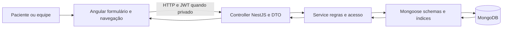
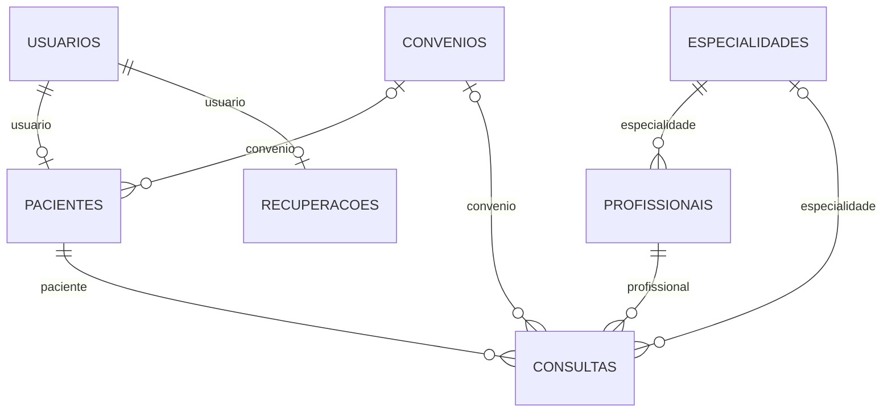

# Arquitetura e execução da Clinora

Revisão de 11/11/2026. Referência funcional: `develop`, merge `d8f60ed` do PR #11, com a revisão documental e do Swagger desta entrega.

O Angular apresenta as informações, valida a entrada para dar retorno rápido e controla os estados de espera e erro. A API valida novamente, autentica, autoriza e aplica as regras. O MongoDB persiste e garante os índices. O navegador nunca recebe acesso direto ao banco.

## Organização

- `frontend/src/app/core`: autenticação, guards, interceptors e contratos básicos.
- `layout` e `pages`: estrutura e páginas públicas.
- `features`: módulos funcionais; `gestao/shared` contém RegistroLista e RegistroForm, configurados pelas rotas.
- `backend/src/<modulo>`: controller, DTO, service e schema. Auth e Usuários cuidam de identidade; Portal aplica a propriedade dos agendamentos.
- `backend/src/documentacao`: complemento do OpenAPI, apenas metadados, exemplos e descrições. Não altera as respostas HTTP reais.

## Desenvolvimento local

O frontend em localhost:4200 chama `environment.apiUrl`, atualmente `http://localhost:3000/api/v1`. A API lê `backend/.env` e acessa `MONGODB_URI`. Neste computador, a conexão normal é `mongodb://127.0.0.1:27017/clinora`.

Mantenha MongoDB e dois terminais ativos: na pasta backend, `npm run start:dev`; na pasta frontend, `npm start`. Verifique `http://localhost:3000/api/docs`. Se só o site abre e a porta 3000 recusa conexão, falta iniciar ou corrigir a API; isso não prova falha no banco.

No CORS de desenvolvimento, aceitam-se portas dos endereços locais localhost, 127.0.0.1 e IPv6 loopback. Em produção, configure NODE_ENV=production e FRONTEND_URL com a origem exata. Não há permissão genérica para sites externos.

## Outro computador

Na pasta do projeto: `git fetch origin`, `git switch develop`, `git pull --ff-only`. Instale as dependências com npm ci em backend e frontend. Crie o .env apenas se ele ainda não existir, configure a URI e execute configurar:auth e seed. O seed não redefine uma senha que já existe no banco. Consulte o README principal para os comandos completos.

Cada localhost aponta para o próprio computador. Compartilhar os mesmos cadastros exige uma conexão compartilhada autorizada ou migração dos registros pelas ferramentas do MongoDB. Um clone ou pull não copia banco nem segredos.

## Segredos e recuperação

JWT_SECRET, credenciais iniciais e SMTP ficam no .env ignorado. Os exemplos de variáveis estão em backend/.env.example, .env.auth.example e .env.email.example. A recuperação exige host ou URL SMTP, remetente e as credenciais do provedor quando requeridas. A entrega externa permanece pendente; não publique senhas nos documentos.

## Dados e referências

Contatos é uma coleção independente. Relatórios não é coleção; consulta as demais. O diagrama representa referências da aplicação, não chaves estrangeiras impostas pelo MongoDB. A escolha é explicada na ADR 001.
