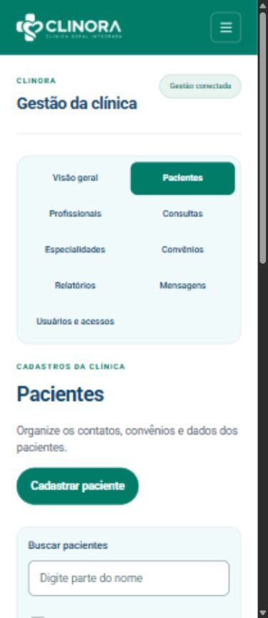
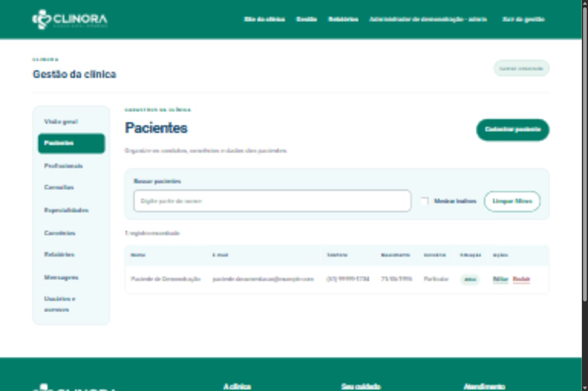
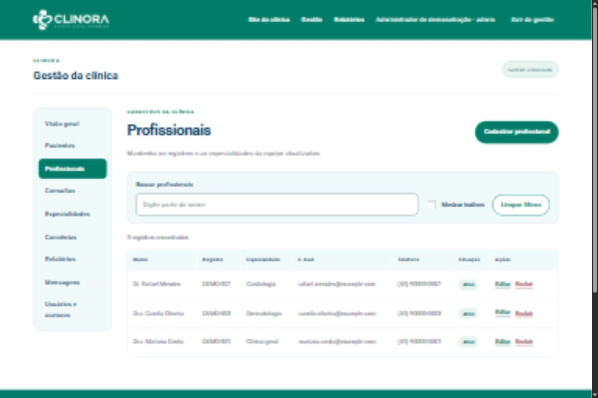
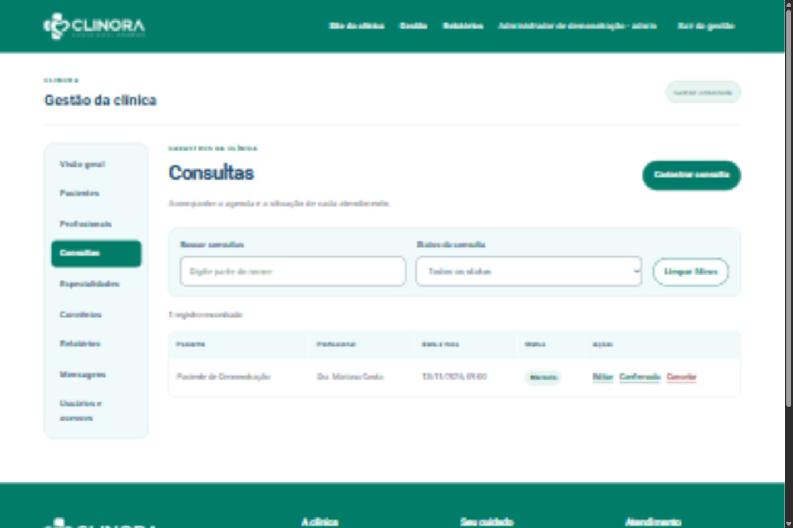
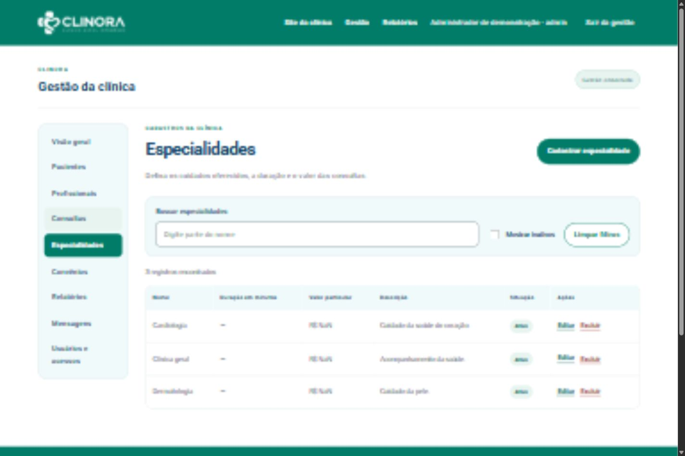
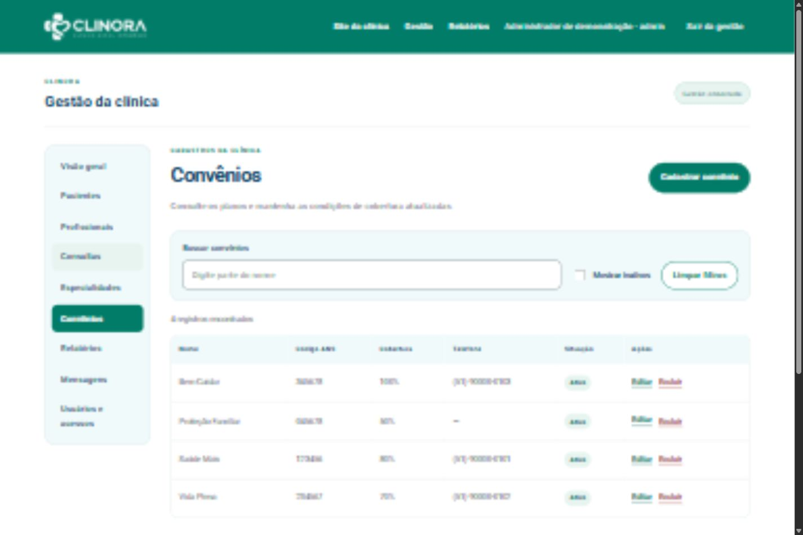
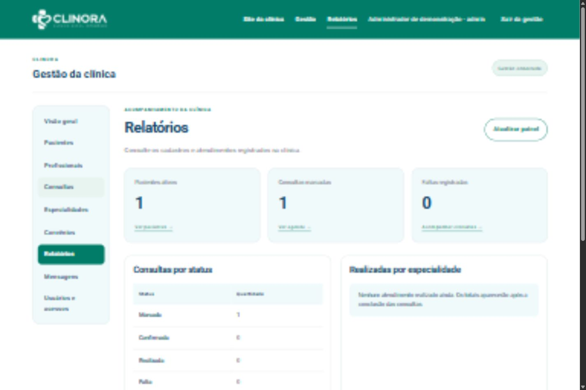

# Manual do Usuário da Clinora

| Sistema | Grupo | Tema | Versão e data |
| --- | --- | --- | --- |
| Clinora | 5 | Clínica | Entrega final 11/11/2026 |

Este manual orienta pacientes, atendentes e administradores no uso do site da Clinora. Explica como entrar, cadastrar informações, acompanhar consultas e interpretar as mensagens. As imagens mostram somente dados fictícios de demonstração.

## 1 Visão geral

A Clinora permite conhecer os profissionais e convênios, agendar uma consulta e acompanhar os atendimentos. A área da equipe organiza pacientes, profissionais, consultas, especialidades e convênios. Administradores também consultam Relatórios e controlam os acessos.

## 2 Acesso ao sistema

Paciente: use Criar conta, informe nome, e-mail e senha, confirme a senha e a ciência do uso acadêmico. Depois entre em Área do paciente. A conta fica disponível sem confirmação de e-mail nesta versão. Guarde sua senha e use dados fictícios nos testes.

Equipe: escolha Área da equipe e use a conta fornecida pela administração. Atendentes podem manter os cadastros e a agenda. Administradores também podem excluir cadastros, consultar Relatórios e criar acessos de atendentes. A conta de paciente não entra na gestão.

## 3 Navegação

No site, use Profissionais, Convênios, Contato e Agendar. No celular, abra o menu pelo botão no topo. Na gestão, o menu mostra os módulos disponíveis para o seu perfil. Use Sair ao terminar em um computador compartilhado.

## Área do paciente

1. Entre com seu e-mail e senha. 2. Selecione Agendar consulta. 3. Escolha especialidade, profissional, data e um horário disponível. 4. Informe nascimento, telefone e convênio ou Particular. 5. Confira e confirme. Aguarde a confirmação antes de sair da página.

Em Minha área, consulte os próximos atendimentos e o histórico. Abra uma consulta para ver os detalhes. O cancelamento fica disponível apenas para uma consulta própria, futura e ainda não encerrada; confirme antes de concluir. Para mudar o horário, cancele a consulta elegível e agende outra, ou procure a equipe.

Em Meus dados, atualize os contatos e salve. O primeiro agendamento completa sua ficha clínica. Criar apenas a conta não cria uma ficha de atendimento incompleta.

Se esqueceu a senha, use Esqueci minha senha. O envio depende de o serviço de e-mail estar configurado pela equipe. Se o link estiver expirado ou já tiver sido usado, solicite outro. A troca encerra as sessões anteriores.

## Como identificar uma falha

Se o serviço estiver indisponível, os campos permanecem preenchidos. Aguarde e tente novamente. Uma mensagem de e-mail já cadastrado significa que você deve entrar na conta existente. Uma mensagem de horário ocupado exige escolher outro horário. Não repita o envio enquanto o botão estiver aguardando.

## 4 Módulo A Pacientes

| Tarefa | Passo a passo |
| --- | --- |
| Consultar | Abra Pacientes e digite parte do nome. Limpar filtros volta à lista completa de ativos. |
| Cadastrar | Clique Cadastrar paciente. Informe nome, e-mail, telefone, nascimento e, se houver, convênio. Salve com todos os campos válidos. |
| Editar | Na linha ou cartão, clique Editar, ajuste os dados e salve. |
| Excluir | Somente administrador: clique Excluir e confirme. A ficha fica inativa; Mostrar inativos permite encontrá-la. |

E-mail não pode se repetir e nascimento não pode ser futuro. Uma ficha cadastrada pela equipe não cria automaticamente uma conta com senha.

## 5 Módulo B Profissionais

| Tarefa | Passo a passo |
| --- | --- |
| Consultar | Abra Profissionais e busque pelo nome. A lista mostra registro, especialidade e contatos. |
| Cadastrar | Clique Cadastrar profissional. Informe nome, registro, especialidade, e-mail e telefone. Salve. |
| Editar | Clique Editar no profissional, altere os campos e salve. |
| Excluir | Administrador: clique Excluir e confirme a inativação. O histórico não é apagado. |

Registro e e-mail não podem se repetir. A especialidade deve estar cadastrada; ao trocar a especialidade, confira os dados antes de salvar.

## 6 Módulo C Consultas

| Tarefa | Passo a passo |
| --- | --- |
| Consultar | Abra Consultas. Use a busca pelo paciente e o filtro de status. |
| Cadastrar | Clique Cadastrar consulta. Escolha paciente, profissional e data futura em dia útil, dentro do expediente. |
| Editar | Clique Editar em uma consulta permitida, altere os dados e salve. |
| Mudar status | Use Confirmar quando marcada. Depois confirme o resultado do atendimento, como realizada ou falta. Cancelar exige confirmação. |

Um profissional não pode ter duas consultas no mesmo horário. O expediente de marcação vai de segunda a sexta, a partir das 08h e antes das 18h. Marcada pode ser confirmada ou cancelada; confirmada pode ser realizada, falta ou cancelada. Estados finais não voltam ao anterior.

## 7 Módulo D Especialidades

| Tarefa | Passo a passo |
| --- | --- |
| Consultar | Abra Especialidades e use a busca pelo nome. |
| Cadastrar | Clique Cadastrar especialidade. Informe nome, descrição opcional, duração em minutos e valor particular. |
| Editar | Clique Editar, ajuste as informações e salve. |
| Excluir | Administrador: clique Excluir e confirme. A especialidade fica inativa. |

Nome deve ser único; duração inteira entre 15 e 120 minutos e valor não negativo.

## 8 Módulo E Convênios

| Tarefa | Passo a passo |
| --- | --- |
| Consultar | Abra Convênios e busque pelo nome. |
| Cadastrar | Clique Cadastrar convênio. Informe nome, ANS com seis dígitos, percentual de cobertura e demais campos apresentados. |
| Editar | Clique Editar, corrija os dados e salve. |
| Excluir | Administrador: clique Excluir e confirme a inativação. |

ANS possui seis dígitos, inclusive zeros iniciais. Nome e ANS não se repetem; cobertura é um número inteiro de 0 a 100. Consulte a cobertura com a equipe antes de agendar.

## 9 Módulo F Relatórios

| Tarefa | Passo a passo |
| --- | --- |
| Consultar | Como administrador, abra Relatórios no menu. |
| Ler indicadores | Veja pacientes ativos, consultas marcadas e faltas. Marcadas inclui confirmadas. |
| Atualizar | Clique Atualizar painel para consultar os registros atuais. |
| Sem dados | A mensagem de ausência de atendimentos realizados é normal quando nenhuma consulta foi concluída. Não há cadastrar, editar ou excluir em Relatórios. |

Os números abrangem os registros gerais. Nesta versão não existe seleção de período. Por especialidade são contadas somente consultas realizadas.

## 10 Perguntas frequentes

| Pergunta | Resposta |
| --- | --- |
| O cadastro não aparece | A conta do site aparece nos acessos. A ficha clínica surge no primeiro agendamento ou após cadastro pela equipe. Atualize a lista e confira os filtros. |
| Não consigo entrar na gestão | Confirme que usa uma conta de equipe. A conta de paciente entra em Área do paciente. |
| O serviço está indisponível | Aguarde e tente novamente. Na apresentação local, avise o responsável por manter o site e o serviço da clínica ligados. |
| O botão Salvar está desabilitado | Complete os campos obrigatórios e corrija as mensagens. Aguarde o fim do envio anterior. |
| Não vejo Excluir ou Relatórios | Essas funções são do administrador. Atendentes não têm essa permissão. |
| Por que não consigo cancelar | Consultas passadas, encerradas ou de outra conta não podem ser canceladas pelo paciente. |
| Como enviar uma dúvida | Use Contato, escolha o assunto e envie a mensagem. A equipe a recebe em Mensagens; não há resposta automática por e-mail. |
| Como criar um atendente | Administrador: abra Usuários e acessos, preencha os campos e salve. O acesso criado tem perfil de atendente. |
| Os dados são compartilhados entre computadores | Somente se as duas instalações usarem o mesmo banco configurado. Baixar o projeto não copia os cadastros. |
