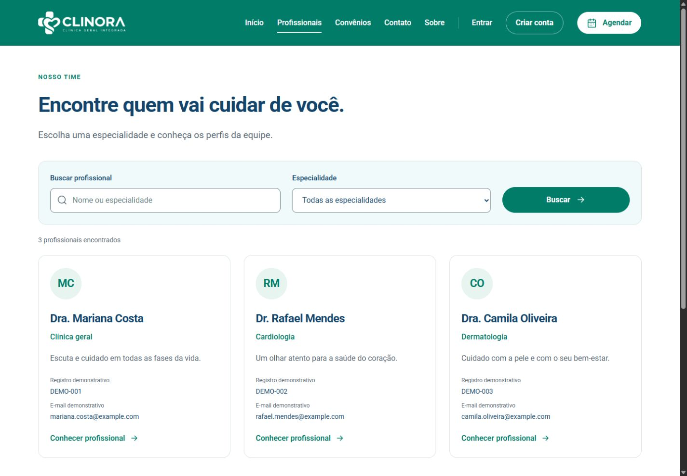
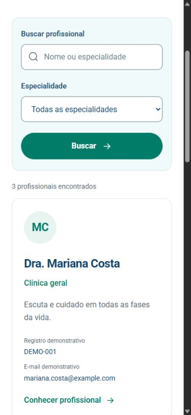

# UI/UX e acessibilidade da Clinora

Branch: `clinica/uiux`. Este guia organiza as decisões visuais já aplicadas ao front, para revisão e manutenção pelo responsável de UI/UX. A entrega técnica Angular está no [PR #2](https://github.com/bryanantonii/Grupo-5-Clinica/pull/2).

## Responsabilidade e material recebido

O papel mantém o padrão visual, revisa a clareza das telas, registra a verificação de responsividade e acessibilidade e mantém os wireframes das telas principais. A implementação funcional dos módulos continua com seus responsáveis.

O projeto de referência é `Clinora _ Identidade original e ícones arredondados.penpot`, fornecido pelo grupo. O arquivo original está fora do repositório; o responsável deve compartilhar o arquivo ou link do Penpot com os demais e registrar a versão revisada. As imagens abaixo já estão versionadas.

| Material existente | Onde conferir |
| --- | --- |
| Padrão visual implementado | [estilos-do-grupo.css](../../frontend/src/estilos-do-grupo.css) |
| Fontes locais | [clinora-fonts.css](../../frontend/src/clinora-fonts.css) e [arquivos de fontes](../../frontend/public/fonts/) |
| Marca verde e marca branca | [imagens da Clinora](../../frontend/public/images/) |
| Cabeçalho, menu e rodapé | [layout](../../frontend/src/app/layout/) |
| Início e faixa de destaques | [inicio.html](../../frontend/src/app/pages/inicio/inicio.html) e [inicio.ts](../../frontend/src/app/pages/inicio/inicio.ts) |
| Cartão reutilizável | [profissional-card](../../frontend/src/app/features/profissionais/profissional-card/) |
| Evidências de revisão | [capturas da listagem](../evidencias/) |
| Registro da atividade | [documento Word](../atividade-angular-clinora.docx), seções 11 e 12 |

## Padrão visual em uso

| Elemento | Valor ou decisão | Aplicação |
| --- | --- | --- |
| Verde da marca | `#007C68` | Ações principais, links e identidade |
| Verde de interação | `#006353` | Interação dos botões |
| Azul | `#13446C` | Títulos e organização visual |
| Texto secundário | `#526570` | Descrições e informações de apoio |
| Fundos suaves | `#F0FAFB` e `#E7F4EF` | Áreas de apoio e destaques |
| Bordas | `#DCE6E7` | Separação de cartões e blocos |
| Borda de campos | `#71878D` | Identificação dos controles |
| Erro | `#A42F30` | Campo inválido acompanhado de mensagem |
| Fonte | Roboto, com alternativas Segoe UI, Arial e sans-serif | Texto, títulos e controles |
| Corpo do texto | 16 px e entrelinha 1,55 na regra geral | Leitura em páginas e formulários |
| Botão principal | Verde, texto branco, bordas arredondadas e altura mínima geral de 54 px | Ação principal da tela |
| Foco | Contorno azul `#145DA0` | Navegação por teclado |

Os tamanhos são os valores gerais do CSS; regras de componentes e media queries adaptam os valores em telas menores. Modifique o estilo do grupo em `estilos-do-grupo.css`, preservando o `styles.css` didático do professor.

## Componentes e feedback

- Mantenha hierarquia de título, texto de apoio e ação principal.
- Use os mesmos botões, campos, bordas e espaçamentos nos módulos.
- Cada campo deve ter rótulo e mensagem clara quando houver erro.
- A lista vazia deve explicar a situação e oferecer uma ação. Em Profissionais, o botão Limpar filtros permite voltar aos resultados.
- As informações de registro e e-mail dos profissionais são demonstrativas, identificadas como tal nos cartões.
- Na integração futura, represente carregamento, sucesso e falha da API com mensagens compreensíveis.

## Ajustes já implementados no celular

O início foi compactado para reduzir o espaço vazio da abertura. Até 600 px, os quatro destaques passam por uma faixa horizontal: Agendamento fácil, Profissionais qualificados, Convênios aceitos e Acesso em qualquer lugar.

A faixa permite deslizar, usar indicadores e navegar com as setas do teclado. O avanço automático ocorre a cada 4,5 segundos quando a faixa está visível, a aba está ativa e não houve pausa. A interação manual pausa o avanço. A preferência por movimento reduzido impede o avanço automático.

O CSS possui adaptações em 1150, 900 e 600 px, além de uma regra para telas a partir de 1440 px. Esses pontos de ajuste não equivalem a uma certificação de todos os tamanhos.

## Evidências existentes

As capturas foram obtidas na revisão anterior do front em 26 de outubro de 2026. Elas permitem verificar a implementação de referência; não representam uma nova avaliação feita pelo integrante que assumir o papel.

O [estado vazio](../evidencias/listagem-profissionais-vazia.jpg) complementa a revisão de feedback. Consulte o [checklist de acessibilidade e responsividade](checklist-acessibilidade.md) para distinguir as verificações existentes das pendências.

## Próximas ações do responsável

1. Conferir no Penpot as telas implementadas e atualizar os wireframes que mudaram.
2. Revisar o checklist em todas as rotas, registrando data, tamanho de tela, navegador e resultado.
3. Conferir contraste, zoom, leitor de tela, estados de foco e mensagens.
4. Combinar correções com os responsáveis pelos módulos e registrar os ajustes em PR.
5. Enviar à pessoa da documentação as decisões visuais, capturas e resultados revisados.

Criar a branch e reunir o material não conclui esses passos. Consulte a [organização das branches](../organizacao-das-branches.md).
